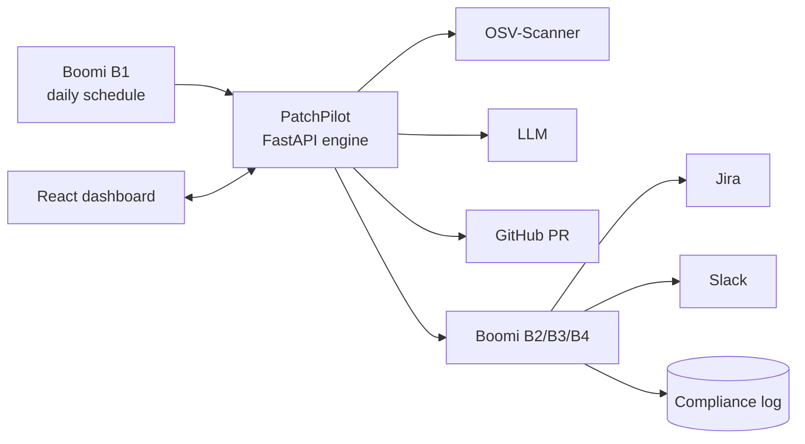

# PatchPilot — AI vulnerability-to-fix autopilot

EasyStepIn AI Hackathon 2026 · Team PatchPilot

> 300 alerts become the 3 that matter — each with a tested fix, a Jira ticket and an audit trail. Automatically, every day.

## Project status (Oct 28)
This repository is the **practice-run copy** (`patchpilot-dryrun`): the plan plus the code built during the rehearsal.
The real event repo (`BommepalliRoop/patchpilot`) holds only the plan; its code is written during the event (Oct 28, 9:20–12:20).

| Area | Tasks | State |
|---|---|---|
| Backend (FastAPI, Python) | T00–T10: scaffold, data layer, cloner + OSV scanner, pipeline + SSE, LLM client, symbols, reachability, risk, fixer, GitHub PR, Boomi client | ✅ done · 375 tests pass (mock mode) |
| Frontend (React + Vite) | T11–T14: design system, overview + live scan, finding page, integrations + compliance | ✅ done · 43 tests pass |
| Demo target repo | T15: `github.com/BommepalliRoop/demo-target` (Python + Node, ~35 alerts) | ✅ done |
| Deployment | T16: Dockerfile, Railway / Render / Vercel configs ([DEPLOY](docs/DEPLOY.md)) | ✅ done (not deployed yet) |
| End-to-end + live modes | T17: LLM → GitHub → Boomi switched to live, demo seed, two full runs | ⏳ next |
| Polish + rehearsal | T18 | ⏳ after T17 |
| Boomi (B0–B4) | Setup, finding notification (Jira + Slack + compliance log), daily trigger, summary, compliance report | ⏳ in progress: account, runtime, plugin and compliance table ready; processes not built ([boomi/](boomi/README.md)) |

Everything runs in **mock mode** by default (`LLM_MODE`, `BOOMI_MODE`, `GITHUB_MODE`); no real keys have been exercised yet.
Per-task detail: [tasks/STATUS.md](tasks/STATUS.md).

## Quick start (local)
```bash
cp .env.example .env                 # then fill in values; .env is gitignored, never commit it
cd backend && pip install -r requirements.txt && uvicorn app.main:app --reload --port 8000
cd frontend && npm install && npm run dev        # http://localhost:5173 (VITE_USE_MOCK=true works without the backend)
cd backend && pytest -q                          # backend tests
cd frontend && npx vitest run                    # frontend tests
```
Windows without `make`: `powershell -File scripts/dev.ps1` starts both apps. Python 3.11 is the target; the practice run used 3.13.

## What it does
IT service companies maintain many client codebases. Dependency scanners report hundreds of CVEs, mostly in library
code the application never calls, so the dangerous ones stay open for weeks. PatchPilot, for every client repo:

1. Scans dependencies (OSV-Scanner) and tags each CVE with real-world exploit data (CISA KEV, EPSS).
2. AI extracts the vulnerable functions from each advisory.
3. Python AST + AI prove whether our code actually calls them (file:line evidence, inside a web route or not).
4. Scores real risk: CVSS × reachability × exposure × exploit data → P1–P4.
5. Upgrades the library, runs the tests, lets AI patch broken code (max 2 retries).
6. Opens a GitHub pull request with the explanation.
7. Boomi creates the Jira ticket, posts the Slack alert and writes the compliance log.



## Requirements
**Functional**
- Fully automated: daily via Boomi (B1) or on demand from the dashboard; no human in the normal path.
- Works for any language OSV understands (Python, JavaScript/TypeScript, Java, Go, Rust, PHP, .NET, Ruby);
  Python gets deep code-parser reachability, other languages text + AI reachability.
- Reachability with evidence (file, line, code snippet, in-route flag) for every finding.
- Risk score and priority P1–P4 per finding.
- Tested fix: upgrade + test run + AI patch (max 2 tries) → `fixed` or `needs_human` (Python + npm at the event;
  other ecosystems get an upgrade PR marked "tests not run" when their toolchain is missing).
- One GitHub PR per vulnerable package, never auto-merged.
- Boomi: Jira issue + Slack alert + compliance log per finding; Slack summary per scan; compliance report per client.
- Live dashboard: overview stats, live pipeline view, finding detail, integrations, compliance.

**Non-functional**
- Professional, motion-rich, dark-first UI ([UI spec](docs/UI_SPEC.md)).
- Mock mode for every external service (`LLM_MODE`, `BOOMI_MODE`, `GITHUB_MODE`) so lanes never block.
- Security: only allowed repos are scanned, scanned code runs in a temp venv without our secrets, secrets masked in logs,
  AI patches restricted ([RISKS](docs/RISKS.md)).
- Scan → Jira + Slack in under 2 minutes on the demo repo.
- Contracts are the source of truth ([API contracts](docs/API_CONTRACTS.md)).

## Tech stack
Full details with reasons: [docs/TECH_STACK.md](docs/TECH_STACK.md).

**Backend** (`backend/`)
| Purpose | Choice |
|---|---|
| Language | Python 3.11 |
| API framework / server | FastAPI + Uvicorn |
| Live progress | Server-Sent Events (`sse-starlette`) |
| Database | SQLite via SQLModel (app data) · PostgreSQL on Supabase (Boomi compliance log) |
| Config | `pydantic-settings` (`.env`) |
| HTTP client | httpx |
| Git / GitHub | GitPython · PyGithub |
| Vulnerability data | OSV-Scanner CLI (fallback: OSV.dev API) |
| Exploit data | CISA KEV feed + FIRST EPSS API |
| CVSS score | `cvss` |
| Versions / names | `packaging` |
| Code analysis | Python `ast` (deep) · regex import/symbol search + LLM for other languages |
| Tests | pytest |

**AI**
| Purpose | Choice |
|---|---|
| Client | Provider-agnostic `app/services/llm.py` (`anthropic` / `openai`-compatible; keys at kickoff) |
| Prompts | `backend/app/prompts/*.md`: extract_symbols, reachability_verdict, patch_code, pr_description |
| Output | JSON only, validated with Pydantic, retry once, safe fallback |

**Frontend** (`frontend/`)
| Purpose | Choice |
|---|---|
| Framework | React 18 + Vite + TypeScript |
| Styling | Tailwind CSS + shadcn/ui |
| Motion | Motion (`motion/react`) + Magic UI / Aceternity UI (NumberTicker, AnimatedBeam, BorderBeam) |
| Routing | react-router-dom |
| Charts | Recharts (or Tremor) |
| Code / diff view | Shiki (`github-dark`) |
| Icons | lucide-react |
| Fonts | Inter · JetBrains Mono |

**Integration and deployment**
| Purpose | Choice |
|---|---|
| Integration | Boomi Integration built with Boomi Companion — processes B1–B4 ([handoff](docs/BOOMI_HANDOFF.md)) |
| Backend hosting | Docker on Railway or Render |
| Frontend hosting | Vercel |
| Fallback | Laptop + Cloudflare Tunnel |

**Build tooling:** Claude Code — Opus 5.5 (hard tasks), Sonnet 5.5 (most tasks), Haiku 5.5 (small tasks); model and
effort per task in [tasks/BOARD.md](tasks/BOARD.md).

## Documents
| You are | Read |
|---|---|
| Claude Code (first session) | [CONTEXT.md](CONTEXT.md), then [CLAUDE.md](CLAUDE.md) |
| Anyone | [Decisions](docs/DECISIONS.md) · [Plan](docs/PLAN.md) · [Setup](docs/SETUP.md) |
| Developer using Claude Code | [CLAUDE.md](CLAUDE.md), then [Task board](tasks/BOARD.md) |
| Architect / reviewer | [Tech stack](docs/TECH_STACK.md) · [Architecture](docs/ARCHITECTURE.md) · [Diagrams](docs/DIAGRAMS.md) |
| Boomi team | [Boomi handoff](docs/BOOMI_HANDOFF.md) · [Boomi flow, low level](docs/BOOMI_FLOW.md) (+ [boomi/](boomi/README.md) for their exports) |
| Whoever collects keys and URLs | [Config](docs/CONFIG.md) |
| Safety questions | [Risks](docs/RISKS.md) |
| Practice run | [Dry run](docs/DRY_RUN.md) |
| Team briefing, simple (8 steps) | [overview.html](docs/overview.html) — download and open in a browser |
| Team briefing (visual walkthrough) | [walkthrough.html](docs/walkthrough.html) — download and open in a browser |
| Presenter | [Demo script](docs/DEMO_SCRIPT.md) · [Demo repos](docs/DEMO_REPOS.md) |
| Deploying | [Deploy](docs/DEPLOY.md) |
| Using / testing the app | [User guide](docs/USER_GUIDE.md) |
| UI developers | [UI spec](docs/UI_SPEC.md) |

## How we work on the day
1. Open the repo in Claude Code.
2. Pick your lane in [tasks/BOARD.md](tasks/BOARD.md).
3. Open a new session, set the model **and effort** listed for the task, then run `/run-task T0X`.
4. When Claude finishes, its NEXT block names the next task, model, effort and command. Run `/next-task` any time.
