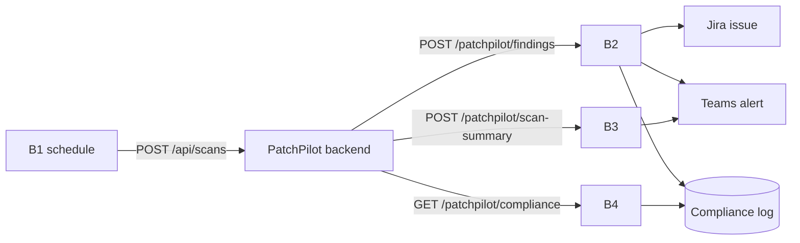

# PatchPilot — Boomi team handoff (everything in one file)

This single file is all the Boomi team needs, from zero to done. Every JSON payload, mapping, test call and
Boomi Companion prompt is inside it — you do not need the GitHub repo to build. (The same payloads also live in
the repo under `contracts/boomi/` for the dev team.)

You own all Boomi work; the dev team never edits your processes. The only coupling between our teams is HTTP:
the endpoints, JSON shapes and auth below. If you think anything here needs to change, tell the Lead (Roop)
**before** building it.

**About Boomi Companion:** use it to generate each process from the prompts in section 12 — it saves most of
the clicking. It will not get everything right on the first try: your Boomi expert must check the generated
maps and connections, deploy, and run the test calls in section 9. A process is only "done" when its test call passes.

**Today's practice run:** build everything in a Boomi folder named `DRYRUN - PatchPilot` and do not reuse
it tomorrow (hackathon rule: everything is built during the event). Tomorrow, rebuild in a fresh folder.

**Version:** v3.5 (Oct 27). Changes since earlier copies:
- v2: idempotency (`Idempotency-Key` header, `finding_id` column in the compliance log), new `event` / `fix_status`
  values, optional `owner_email`.
- v3: exploit data in B2 — `kev`, `epss`, `epss_percentile` (section 5); Jira label `actively-exploited` and an
  "Exploit data" description line; Teams card shows the exploit line (section 6).
- v3.1: compliance log also stores `jira_url` and `teams_sent` (needed for the idempotent replay); common response
  rules for all endpoints (section 5a); Teams title for `finding.open`; B3 duplicate handling; schedule time zone.
- v3.2: compliance log store decided — **PostgreSQL** (table SQL + the 3 queries in section 4); the Lead creates it
  and sends the connection details privately (section 4b). Google Sheet only as fallback.
- v3.3: PatchPilot works for all languages — B2 has a new `ecosystem` field (PyPI, npm, Maven, Go, …) and a new
  `fix_status` value `fixed_untested` (upgrade PR opened, tests not run). Show the language in Jira and Teams.
- v3.4: section 2a "API reference" — every endpoint, payload, success and error response in one place;
  example `compliance_log_id` is now `log_fnd_07` (= `'log_' + finding_id`, as in section 4a).
- v3.5: compliance database moved to **Supabase** (PostgreSQL). Same table and queries; new connection details in
  section 4b — use the Supabase **Session pooler** address (port 5432), not the direct `db.<ref>.supabase.co` host.
If you started from an older copy, apply these changes; nothing else changed.

**Working in parallel:** you do not wait for us. The dev team builds the app at the same time with Boomi in
mock mode. You test every process with the curl calls in section 9 (no PatchPilot needed). We connect the two
sides at the times in section 10.

**What we need from you — deliverables**
| # | Deliverable | When (event day) | Done when |
|---|---|---|---|
| D1 | `BOOMI_BASE_URL` + exact paths for B2/B3/B4, `BOOMI_USER` (team chat), `BOOMI_TOKEN` (private message to the Lead) | 10:30 | We can call your B2 with curl |
| D2 | Jira site URL + project key, Teams channel name | 10:30 | Shared in team chat |
| D3 | **B2 live** — Jira issue + Teams card + compliance row + idempotency | 11:15 | Section 0 items 2.3–2.5 pass; screenshots shared |
| D4 | **B1 live** — scheduled + manual "Execute" calls our `BACKEND_URL` | 11:40 | Execute returns 202 with a `scan_id` |
| D5 | **B3 live** — Teams summary card | 11:50 | Test call shows the card |
| D6 | **B4 live** — compliance report | 11:50 | Test call returns the rows written by B2 |
| D7 | Screenshots + notes in the repo `boomi/` folder | 12:15 | Pull request opened |
| D8 | One person explains B1–B4 in 30 s during the demo | 12:25 | — |

For the practice run, use the same order and count the times from your start.

## 0. Checklist — zero to done
Tick these in order. Times are for the event day (Oct 28); for the practice run, count from your start time.

**Before the sprint (accounts only, no process building)**
- [ ] 0.1 Every Boomi team member can log in to Boomi and open Boomi Companion.
- [ ] 0.2 A Boomi **Atom Cloud** (or cloud Atom) is available with a public HTTPS URL (section 3).
- [ ] 0.3 Jira Cloud site + a project (e.g. key `SEC`) + a Jira user email and API token.
- [ ] 0.4 A Teams channel for alerts + its webhook URL (section 6).
- [ ] 0.5 Compliance log database: PostgreSQL connection details received from the Lead (section 4b); table exists.
- [ ] 0.6 You received from the Lead: the demo repo URL and the B1 client list (section 10).

**B0 — Setup (by 10:00)**
- [ ] 1.1 Shared Web Server: REST listener on, Basic auth, one user for PatchPilot (section 3).
- [ ] 1.2 Connections: Jira, Teams HTTP, compliance log, PatchPilot HTTP (section 3).
- [ ] 1.3 Send the Lead `BOOMI_BASE_URL`, `BOOMI_USER` (team chat) and `BOOMI_TOKEN` (private message only).

**B2 — Finding notification (by 11:15) — the most important**
- [ ] 2.1 Database connection in Boomi works: run the B4 query → returns 0 rows without error (section 4a).
- [ ] 2.2 Build B2 with the Companion prompt (section 12) and the steps in section 5.
- [ ] 2.3 Deploy; run the B2 test call (section 9) → a Jira issue (with the "Exploit data" line), a Teams card and a log row appear; response matches section 5.
- [ ] 2.4 Run the same call again with the same `Idempotency-Key` → **no** second Jira issue, same `jira_key` returned.
- [ ] 2.5 Send a missing-field request → 400. Tell the Lead "B2 passes" + screenshots.

**B1 — Daily scan trigger (by 11:40)**
- [ ] 3.1 Build B1 (section 7). Point it at webhook.site first and check body + headers.
- [ ] 3.2 When the Lead sends `BACKEND_URL` + `PATCHPILOT_API_KEY`, switch to them; "Execute" → 202 with a `scan_id`.
- [ ] 3.3 Schedule it daily 09:00. Tell the Lead "B1 live".

**B3 — Scan summary (by 11:50)**
- [ ] 4.1 Build B3 (section 8); test call → Teams summary card; response `{ "ok": true, "teams_sent": true }`.

**B4 — Compliance report (by 11:50)**
- [ ] 5.1 Build B4 (section 8); test call → JSON with the rows written by B2; empty result → `"items": []`.

**Demo and wrap-up (11:50–12:20)**
- [ ] 6.1 During the full demo run, watch Jira, Teams and the log; confirm each item appears within ~1 minute.
- [ ] 6.2 Screenshot each process canvas; add them to the repo `boomi/` folder (section 11).
- [ ] 6.3 One person is ready to explain B1–B4 in 30 seconds during the demo.

## 1. What PatchPilot is (30 seconds)
PatchPilot scans a client's code for vulnerable libraries, uses AI to find the few that our code actually
calls, fixes them automatically and opens a GitHub pull request. **Boomi is the integration backbone:**
it starts the daily scans (B1) and turns every finding into a Jira ticket, a Teams alert and a compliance
log row (B2), posts a daily summary (B3), and serves the audit trail (B4).



## 2. Build order and timeline
| Order | ID | Process | Direction | Must work by | Why this order |
|---|---|---|---|---|---|
| 1 | **B0** | Setup: runtime, listener, auth, connections | — | 10:00 | Everything else needs it |
| 2 | **B2** | Finding notification → Jira + Teams + log | PatchPilot → Boomi | 11:15 | The main demo moment |
| 3 | **B1** | Daily scan trigger | Boomi → PatchPilot | 11:40 | Shows "fully automated, every day" |
| 4 | **B3** | Scan summary → Teams card | PatchPilot → Boomi | 11:50 | Nice-to-have |
| 5 | **B4** | Compliance report from the log | PatchPilot → Boomi | 11:50 | Nice-to-have (Compliance page) |

If time is short, finish B0 → B2 → B1. Until your endpoints are live the dev team runs with
`BOOMI_MODE=mock`, so nobody waits on anybody.

**Tonight (no process building, only accounts):** get Boomi access, a Jira project, a Teams channel
with a webhook, and a place for the compliance log (section 4). Check with the organisers whether
building processes before 9:20 is allowed; assume it is not.

## 2a. API reference — all endpoints in one place
Full field lists are in sections 5, 7 and 8; this section is the quick lookup.

| # | Direction | Method + URL | Auth | Request body | Success | Errors |
|---|---|---|---|---|---|---|
| B1 | Boomi → PatchPilot | `POST ${BACKEND_URL}/api/scans` | header `X-API-Key` | client entry (below) | `202` `{scan_id, status}` | `400` `401` `429` |
| B2 | PatchPilot → Boomi | `POST ${BOOMI_BASE_URL}/patchpilot/findings` | Basic + `Idempotency-Key: <finding_id>` | finding (section 5) | `200` `{ok, jira_key, jira_url, teams_sent, compliance_log_id, processed_at}` | `400` `401` `502` `500` |
| B3 | PatchPilot → Boomi | `POST ${BOOMI_BASE_URL}/patchpilot/scan-summary` | Basic + `Idempotency-Key: <scan_id>` | scan summary (section 8) | `200` `{ok, teams_sent}` | `400` `401` `500` |
| B4 | PatchPilot → Boomi | `GET ${BOOMI_BASE_URL}/patchpilot/compliance?client_name=…&from=YYYY-MM-DD` | Basic | none (query parameters) | `200` `{client_name, from, items[]}` | `400` `401` `500` |

All requests and responses use `Content-Type: application/json`, UTF-8, snake_case fields, timestamps in ISO-8601 UTC (`2026-10-28T05:11:40Z`).

**B1 — request** (Boomi sends to us)
```http
POST /api/scans HTTP/1.1
Host: <BACKEND_URL host>
X-API-Key: <PATCHPILOT_API_KEY>
Content-Type: application/json

{ "client_name": "Acme Retail", "repo_url": "https://github.com/BommepalliRoop/demo-target", "branch": "main",
  "auto_fix": true, "owner_email": "owner@easystepin.com" }
```
**B1 — responses** (we send back)
```json
202 { "scan_id": "scn_01", "status": "queued" }
400 { "error": { "code": "repo_not_allowed", "message": "repo_url is not on the allowed list" } }
400 { "error": { "code": "invalid_request", "message": "branch: invalid characters" } }
401 { "error": { "code": "unauthorized", "message": "missing or wrong X-API-Key" } }
429 { "error": { "code": "rate_limited", "message": "too many scans this hour" } }
```

**B2 — request** (we send to Boomi; full body in section 5)
```http
POST /ws/rest/patchpilot/findings HTTP/1.1
Host: <BOOMI_BASE_URL host>
Authorization: Basic <base64(BOOMI_USER:BOOMI_TOKEN)>
Idempotency-Key: fnd_07
Content-Type: application/json

{ "event": "finding.fixed", "scan_id": "scn_01", "finding_id": "fnd_07", "client_name": "Acme Retail", "cve_id": "CVE-2020-14343",
  "package": "pyyaml", "ecosystem": "PyPI", "priority": "P1", "fix_status": "fixed", "pr_url": "https://github.com/...", "...": "see section 5" }
```
**B2 — responses** (Boomi sends back)
```json
200 { "ok": true, "jira_key": "SEC-101", "jira_url": "https://<site>.atlassian.net/browse/SEC-101",
      "teams_sent": true, "compliance_log_id": "log_fnd_07", "processed_at": "2026-10-28T05:11:40Z" }
200 { "ok": true, "jira_key": "SEC-101", "jira_url": "...", "teams_sent": false, "compliance_log_id": "log_fnd_07", "processed_at": "..." }   ← Teams failed, Jira worked
400 { "ok": false, "error": "invalid_request", "message": "missing cve_id" }
401 { "ok": false, "error": "unauthorized", "message": "bad credentials" }
502 { "ok": false, "error": "jira_create_failed", "message": "Jira returned 400: project SEC not found" }
500 { "ok": false, "error": "log_write_failed", "message": "compliance log insert failed" }
```
A repeated `Idempotency-Key` returns the **same 200 body** as the first call (no new Jira issue).

**B3 — request / responses** (full body in section 8)
```json
POST /ws/rest/patchpilot/scan-summary   (Basic auth, Idempotency-Key: scn_01)
{ "event": "scan.completed", "scan_id": "scn_01", "client_name": "Acme Retail", "repo_url": "https://github.com/...",
  "finished_at": "2026-10-28T05:11:42Z",
  "stats": { "total_alerts": 35, "reachable": 3, "unsure": 1, "not_reachable": 31, "p1": 1, "p2": 1, "fixed": 2, "prs_opened": 2 },
  "dashboard_url": "https://patchpilot.vercel.app/scans/scn_01" }

200 { "ok": true, "teams_sent": true }
500 { "ok": false, "error": "internal_error", "message": "Teams webhook returned 400" }
```

**B4 — request / responses**
```json
GET /ws/rest/patchpilot/compliance?client_name=Acme%20Retail&from=2026-10-01   (Basic auth, no body)

200 { "client_name": "Acme Retail", "from": "2026-10-01",
      "items": [ { "compliance_log_id": "log_fnd_07", "cve_id": "CVE-2020-14343", "package": "pyyaml", "priority": "P1",
                   "detected_at": "2026-10-28T05:10:05Z", "fixed_at": "2026-10-28T05:11:40Z", "time_to_fix_minutes": 2,
                   "jira_key": "SEC-101", "pr_url": "https://github.com/.../pull/3", "status": "fixed" } ] }
200 { "client_name": "Acme Retail", "from": "2026-10-01", "items": [] }   ← nothing found
400 { "ok": false, "error": "invalid_request", "message": "from must be YYYY-MM-DD" }
```
The `/ws/rest` prefix is Boomi's usual REST path; use whatever your Atom shows and tell the Lead the exact URLs.

## 3. B0 — Setup
1. **Runtime with a public URL.** Use a Boomi **Atom Cloud** (or a cloud-hosted Atom) so PatchPilot
   on Render/Railway can reach your listeners over HTTPS. A local Atom on a laptop is not reachable from outside.
2. **Shared Web Server:** REST listener enabled, authentication **Basic**. Create one user for PatchPilot
   in Shared Web Server → User Management. Its user name + token become our `BOOMI_USER` / `BOOMI_TOKEN`.
3. **Base URL:** something like `https://<cloud-host>/ws/rest`. Our client calls
   `${BOOMI_BASE_URL}/patchpilot/findings`, `.../patchpilot/scan-summary`, `.../patchpilot/compliance`.
   If Boomi forces different paths, tell us the exact paths; we can set them per endpoint
   (`BOOMI_B2_PATH`, `BOOMI_B3_PATH`, `BOOMI_B4_PATH`).
4. **Connections** (keep secrets inside Boomi):
   | Connection | Type | Settings |
   |---|---|---|
   | Jira | Jira connector, or HTTP Client | Jira Cloud site URL, user email + Jira API token (id.atlassian.com → Security → API tokens) |
   | Teams | HTTP Client | Teams webhook URL (section 6) |
   | Compliance log | Database connector (PostgreSQL) | Details from the Lead (section 4b); fallback Google Sheets connector |
   | PatchPilot | HTTP Client | `BACKEND_URL`, header `X-API-Key` (we send it privately) |
5. Deploy each process to the environment attached to the runtime, then test with the curl calls in section 9.

## 4. Compliance log — one row per finding
| Column | Type | From |
|---|---|---|
| compliance_log_id | string, you generate (e.g. `log_fnd_07`) | B2 |
| finding_id | string, unique — used for idempotency | B2 request / `Idempotency-Key` header |
| client_name, repo_url, cve_id, package, priority | string | B2 request |
| detected_at | ISO-8601 UTC | B2 request |
| fixed_at | ISO-8601 UTC, = processing time when `fix_status` = `fixed`, else empty (B4 returns `null`) | B2 |
| jira_key, jira_url | string | Jira response (returned again on an idempotent replay) |
| teams_sent | boolean | Result of the Teams post |
| pr_url | string, may be empty | B2 request |
| status | `fixed` / `needs_human` / `open` | B2 `fix_status` (`not_attempted` → `open`, `fixed_untested` → `needs_human`) |

`time_to_fix_minutes` for B4 = `fixed_at − detected_at` in whole minutes (`null` if not fixed).

### 4a. Store: PostgreSQL (decided)
A free **Supabase** project (PostgreSQL), created by the Lead. Use Boomi's **Database connector**
(PostgreSQL JDBC). First thing in B0: confirm your Atom Cloud can use the PostgreSQL driver — if it cannot, tell the
Lead immediately and use the fallback (a Google Sheet with the same columns via the Google Sheets connector).

Table (the Lead runs this once; shown so you know the columns):
```sql
CREATE TABLE compliance_log (
  compliance_log_id TEXT PRIMARY KEY,              -- 'log_' || finding_id
  finding_id        TEXT NOT NULL UNIQUE,          -- idempotency key
  scan_id           TEXT,
  client_name       TEXT NOT NULL,
  repo_url          TEXT NOT NULL,
  cve_id            TEXT NOT NULL,
  package           TEXT NOT NULL,
  priority          TEXT NOT NULL CHECK (priority IN ('P1','P2','P3','P4')),
  kev               BOOLEAN NOT NULL DEFAULT FALSE,
  detected_at       TIMESTAMPTZ NOT NULL,
  fixed_at          TIMESTAMPTZ,
  jira_key          TEXT,
  jira_url          TEXT,
  teams_sent        BOOLEAN NOT NULL DEFAULT FALSE,
  pr_url            TEXT,
  status            TEXT NOT NULL CHECK (status IN ('fixed','needs_human','open')),
  created_at        TIMESTAMPTZ NOT NULL DEFAULT now()
);
CREATE INDEX compliance_log_client_date ON compliance_log (client_name, detected_at);
```

The three queries your processes need (`?` = parameters):
```sql
-- B2 step 1: idempotency check (by finding_id)
SELECT compliance_log_id, jira_key, jira_url, teams_sent
FROM compliance_log WHERE finding_id = ?;

-- B2 step 5: insert the row (compliance_log_id = 'log_' + finding_id)
INSERT INTO compliance_log (compliance_log_id, finding_id, scan_id, client_name, repo_url, cve_id, package,
  priority, kev, detected_at, fixed_at, jira_key, jira_url, teams_sent, pr_url, status)
VALUES (?, ?, ?, ?, ?, ?, ?, ?, ?, ?::timestamptz, ?::timestamptz, ?, ?, ?, ?, ?)
ON CONFLICT (finding_id) DO NOTHING;

-- B4: compliance report
SELECT compliance_log_id, cve_id, package, priority, detected_at, fixed_at,
       CASE WHEN fixed_at IS NULL THEN NULL
            ELSE FLOOR(EXTRACT(EPOCH FROM (fixed_at - detected_at)) / 60)::int END AS time_to_fix_minutes,
       jira_key, pr_url, status
FROM compliance_log
WHERE client_name = ? AND detected_at >= ?::date
ORDER BY detected_at DESC;
```
`fixed_at` = processing time when `fix_status` = `fixed`, else NULL. `status`: `fixed` / `needs_human` / `open`
(`not_attempted` → `open`, `fixed_untested` → `needs_human`).

### 4b. Connection details (the Lead sends these privately)
Where to find them: Supabase dashboard → project `patchpilot` → **Connect** → **Session pooler**.

| Setting | Value |
|---|---|
| Host (Session pooler) | `aws-0-<region>.pooler.supabase.com` (filled in by the Lead) |
| Port | `5432` (session mode) |
| Database | `postgres` |
| User | `postgres.<project-ref>` (filled in by the Lead) |
| Password | the database password — private message from the Lead only |
| SSL | required (`sslmode=require`) |
| JDBC URL | `jdbc:postgresql://aws-0-<region>.pooler.supabase.com:5432/postgres?sslmode=require` |

Why the Session pooler: Supabase's direct host `db.<project-ref>.supabase.co` is IPv6-only on the free plan, and many
Boomi runtimes only speak IPv4. The Session pooler (port **5432**) works over IPv4 and supports JDBC prepared statements.
Do **not** use the Transaction pooler (port 6543) — it breaks prepared statements.

Status: table to be created by the Lead in Supabase → SQL Editor with the SQL above (same table and queries as before).

The Lead also sends, privately: Jira site URL, Jira user email, Jira API token, Jira project key, and the Teams
webhook URL — unless your team already has its own Jira/Teams set up, in which case tell the Lead which ones you use.

## 5. B2 — Finding notification (the main one)
`POST ${BOOMI_BASE_URL}/patchpilot/findings` · Basic auth · `Content-Type: application/json` · reply within 15 s.
PatchPilot sends one call per reachable finding (usually 1–3 per scan). We retry once on 5xx.

**Request** (save as `b2.json` for the test call):
```json
{
  "event": "finding.fixed",
  "scan_id": "scn_01",
  "finding_id": "fnd_07",
  "client_name": "Acme Retail",
  "repo_url": "https://github.com/<org>/demo-target",
  "cve_id": "CVE-2020-14343",
  "package": "pyyaml",
  "ecosystem": "PyPI",
  "installed_version": "5.3.1",
  "fixed_version": "5.4.1",
  "cvss": 9.8,
  "priority": "P1",
  "score": 10.0,
  "kev": false,
  "epss": 0.0598,
  "epss_percentile": 0.9326,
  "reachability": "reachable",
  "confidence": 0.93,
  "summary": "Arbitrary code execution via full_load / FullLoader",
  "ai_explanation": "User-supplied YAML from POST /import reaches yaml.load without SafeLoader.",
  "evidence": [ { "file": "app/routes.py", "line": 42, "in_route": true } ],
  "fix_status": "fixed",
  "tests_passed": true,
  "pr_url": "https://github.com/<org>/demo-target/pull/3",
  "owner_email": "owner@easystepin.com",
  "detected_at": "2026-10-28T05:10:05Z"
}
```
Field notes: `event` finding.fixed / finding.needs_human / finding.open · `priority` P1–P4 ·
`reachability` reachable / unsure · `fix_status` fixed / fixed_untested / needs_human / not_attempted ·
`pr_url` empty unless `fix_status` = `fixed` or `fixed_untested` · `owner_email` may be empty · `evidence` has 1+ items ·
`kev` true = CVE is on the CISA "actively exploited" list · `epss` = chance of exploitation in 30 days (0–1),
`epss_percentile` (0–1); both may be `null` · `ecosystem` = language/package system: `PyPI` (Python), `npm` (JavaScript),
`Maven` (Java), `Go`, `crates.io` (Rust), `Packagist` (PHP), `NuGet` (.NET), `RubyGems` (Ruby) ·
`fix_status` `fixed_untested` = upgrade PR opened but PatchPilot could not run the tests.
Several findings in the same package share one `pr_url` (one PR per package) — still create one Jira issue per finding.

**Process steps**
1. Listener receives JSON → validate required fields (`finding_id`, `cve_id`, `package`, `priority`, `client_name`).
   Missing → 400 `{ "ok": false, "error": "invalid_request", "message": "missing cve_id" }`.
   **Idempotency:** read header `Idempotency-Key` (= `finding_id`). If the compliance log already has a row for that
   `finding_id`, skip steps 2–5 and return the stored `jira_key`/`jira_url`/`teams_sent`/`compliance_log_id` (we retry after timeouts,
   so without this you get duplicate Jira tickets). Store `finding_id` in the log row.
2. Decision on `priority`: P1/P2 = urgent branch (Jira Highest/High, Teams card marked urgent); P3/P4 = normal.
3. Create Jira issue (mapping below) → keep `key` and build `jira_url` = `<site>/browse/<key>`.
4. Post Teams message (section 6) with links to `pr_url` and `jira_url`.
5. Insert compliance log row (section 4).
6. Return the response.

**Jira mapping**
| Jira field | Value |
|---|---|
| Project | your project key (e.g. `SEC`) |
| Issue type | Bug (or Task) |
| Summary | `[{priority}] {cve_id} in {package} ({ecosystem}) — {client_name}` |
| Priority | P1→Highest, P2→High, P3→Medium, P4→Low |
| Description | summary, ai_explanation, evidence `file:line` (+ "in web route" if `in_route`), `installed_version → fixed_version`, fix_status, tests_passed, pr_url |
| Labels | `patchpilot`, `security`, client name slug (e.g. `acme-retail`), plus `actively-exploited` when `kev` is true |
| Description (extra line) | `Exploit data: CISA KEV = yes/no · EPSS {epss×100}% (top {(1−epss_percentile)×100}%)`; write `n/a` when null |

Tip: Jira Cloud REST **v3** needs the description in Atlassian Document Format. If you use the HTTP Client,
call `/rest/api/2/issue`, which accepts a plain-text description.

**Response 200:**
```json
{ "ok": true, "jira_key": "SEC-101", "jira_url": "https://<site>.atlassian.net/browse/SEC-101",
  "teams_sent": true, "compliance_log_id": "log_fnd_07", "processed_at": "2026-10-28T05:11:40Z" }
```
If Teams fails but Jira worked, still return 200 with `"teams_sent": false`.
If Jira fails: 502 with `{ "ok": false, "error": "jira_create_failed", "message": "..." }`.

## 5a. Response rules for every Boomi endpoint (B2, B3, B4)
- Basic auth on every listener; wrong or missing credentials → 401.
- Always JSON. Success → 200 with the documented body. Failure → 4xx/5xx with
  `{ "ok": false, "error": "<code>", "message": "..." }` (codes: `invalid_request`, `unauthorized`,
  `jira_create_failed`, `log_write_failed`, `internal_error`).
- Answer within 15 seconds (our timeout). We retry once on a timeout or 5xx, with the same `Idempotency-Key`.
- Timestamps are ISO-8601 UTC with `Z` (e.g. `2026-10-28T05:11:40Z`).

## 6. Teams message (B2 and B3)
Microsoft is retiring the old Office 365 "Incoming Webhook" connector. If you cannot create one, use the
Teams **Workflows** app → template "Post to a channel when a webhook request is received"; it gives a URL
that accepts an Adaptive Card wrapped like this:
```json
{ "type": "message",
  "attachments": [ { "contentType": "application/vnd.microsoft.card.adaptive",
                     "content": { "type": "AdaptiveCard", "version": "1.4", "body": [ ... ], "actions": [ ... ] } } ] }
```
**B2 card:** title by `event` — `finding.fixed`: `{priority} vulnerability fixed automatically`;
`finding.needs_human`: `{priority} vulnerability needs review`; `fix_status` = `fixed_untested`:
`{priority} upgrade PR ready — please run tests`; `finding.open`: `{priority} vulnerability found (auto-fix off)`.
Hide the "Open pull request" button when `pr_url` is empty · facts: client, repo, CVE, package `installed → fixed`, why it is reachable
(`ai_explanation`), evidence `file:line`, exploit data ("🔥 Actively exploited (CISA KEV)" when `kev`;
"EPSS 6% · top 7%" from `epss`/`epss_percentile`, hidden when null) · buttons: "Open pull request" (`pr_url`), "Open Jira" (`jira_url`).

**B3 card:** title `PatchPilot daily scan — {client_name}` · facts: total alerts, real risks (reachable),
P1, P2, fixed, PRs opened · button: "Open dashboard" (`dashboard_url`).

## 7. B1 — Daily scan trigger (Boomi → PatchPilot)
- Trigger: process schedule daily 09:00 **IST** (check the Atom's time zone), plus manual "Execute" during the demo.
- Client list: static JSON in a Message shape or a Cross Reference Table. For the demo, one entry:
  ```json
  [ { "client_name": "Acme Retail", "repo_url": "<DEMO_REPO_URL, we send it>", "branch": "main", "auto_fix": true,
    "owner_email": "<repo owner email>" } ]
  ```
- For each entry: `POST ${BACKEND_URL}/api/scans`, header `X-API-Key: <PATCHPILOT_API_KEY>`,
  `Content-Type: application/json`, body = the entry.
- Expected: `202 { "scan_id": "scn_01", "status": "queued" }` → log the scan_id (process log is enough).
- Other answers from us: `400 repo_not_allowed` / `400 invalid_request` (check the client list), `401 unauthorized`
  (wrong `X-API-Key`), `429 rate_limited` (wait and retry later). Errors look like
  `{ "error": { "code": "unauthorized", "message": "..." } }`.
- If the same repo is already being scanned we return that scan's id — no duplicate scans.
- Until we share `BACKEND_URL` (~11:40), point the HTTP Client at a request-catcher such as webhook.site
  to check the body and headers, then swap the URL.

## 8. B3 and B4
**B3 — Scan summary** · `POST ${BOOMI_BASE_URL}/patchpilot/scan-summary` · one call at the end of each scan.
Request (save as `b3.json` for the test call):
```json
{ "event": "scan.completed", "scan_id": "scn_01", "client_name": "Acme Retail",
  "repo_url": "https://github.com/<org>/demo-target", "finished_at": "2026-10-28T05:11:42Z",
  "stats": { "total_alerts": 12, "reachable": 2, "unsure": 1, "not_reachable": 9, "p1": 1, "p2": 1, "fixed": 2, "prs_opened": 2 },
  "dashboard_url": "https://patchpilot.vercel.app/scans/scn_01" }
```
Steps: map stats → B3 Teams card → respond `200 { "ok": true, "teams_sent": true }`.
We send header `Idempotency-Key: <scan_id>`. Skipping a repeated key is optional for B3 — a duplicate summary card
is harmless; do it only if it is easy.

**B4 — Compliance report** · `GET ${BOOMI_BASE_URL}/patchpilot/compliance?client_name=Acme%20Retail&from=2026-10-01`
Steps: read query parameters → query the compliance log for that client with `detected_at >= from` → respond:
```json
{ "client_name": "Acme Retail", "from": "2026-10-01",
  "items": [ { "compliance_log_id": "log_fnd_07", "cve_id": "CVE-2020-14343", "package": "pyyaml", "priority": "P1",
               "detected_at": "2026-10-28T05:10:05Z", "fixed_at": "2026-10-28T05:11:40Z", "time_to_fix_minutes": 2,
               "jira_key": "SEC-101", "pr_url": "https://github.com/<org>/demo-target/pull/3", "status": "fixed" } ] }
```
No rows → `200` with `"items": []`. If a GET listener with query parameters is a problem in your setup,
tell the Lead by 10:30 so we agree on an alternative before anyone builds it.

## 9. Test calls
Save the B2 request from section 5 as `b2.json` and the B3 request from section 8 as `b3.json`, then run in
Git Bash / a terminal (or build the same calls in Postman). Set the variables first with your real values.
```bash
# B2 — first call creates Jira + Teams + log row
curl -u "$BOOMI_USER:$BOOMI_TOKEN" -H "Content-Type: application/json" -H "Idempotency-Key: fnd_07" \
  -d @b2.json "$BOOMI_BASE_URL/patchpilot/findings"
# B2 again, same Idempotency-Key — must return the same jira_key, no new issue
curl -u "$BOOMI_USER:$BOOMI_TOKEN" -H "Content-Type: application/json" -H "Idempotency-Key: fnd_07" \
  -d @b2.json "$BOOMI_BASE_URL/patchpilot/findings"
# B2 bad request — must return 400
curl -u "$BOOMI_USER:$BOOMI_TOKEN" -H "Content-Type: application/json" \
  -d '{"event":"finding.fixed"}' "$BOOMI_BASE_URL/patchpilot/findings"
# B3
curl -u "$BOOMI_USER:$BOOMI_TOKEN" -H "Content-Type: application/json" -H "Idempotency-Key: scn_01" \
  -d @b3.json "$BOOMI_BASE_URL/patchpilot/scan-summary"
# B4
curl -u "$BOOMI_USER:$BOOMI_TOKEN" "$BOOMI_BASE_URL/patchpilot/compliance?client_name=Acme%20Retail&from=2026-10-01"
# B1 target (after the Lead sends BACKEND_URL): what your B1 process sends to us
curl -H "X-API-Key: $PATCHPILOT_API_KEY" -H "Content-Type: application/json" \
  -d '{"client_name":"Acme Retail","repo_url":"<DEMO_REPO_URL>","branch":"main","auto_fix":true,"owner_email":""}' \
  "$BACKEND_URL/api/scans"
```
After T10 the dev team can also run `python -m app.services.boomi_client ping` to send the sample B2 call.

## 10. Exchange sheet
| You give us | When | How |
|---|---|---|
| `BOOMI_BASE_URL` and the exact paths for B2/B3/B4 | 10:30 | team chat |
| `BOOMI_USER` | 10:30 | team chat |
| `BOOMI_TOKEN` | 10:30 | **private message to the Lead only** — never in git or a shared channel |
| Jira site URL + project key, Teams channel name (only if you use your own Jira/Teams) | 10:30 | team chat |
| "PostgreSQL driver works on our Atom" (or "we need the Google Sheet fallback") | B0 | team chat |
| "B2 passes the curl test" | 11:15 | team chat + screenshot of the Jira issue and Teams card |
| "B1 points at BACKEND_URL" | 11:40 | team chat |

| We give you | When |
|---|---|
| `DEMO_REPO_URL` and the B1 client list | before you start |
| PostgreSQL connection details (section 4b) | before you start, private message |
| Jira site, email, API token, project key; Teams webhook URL | before you start, private message |
| `BACKEND_URL`, `FRONTEND_URL` | ~11:40 (after deploy) |
| `PATCHPILOT_API_KEY` | ~11:40, private message |

## 11. GitHub — how your work lands in our repo
Boomi processes live in the Boomi platform, not in git, so there is no code to merge. To keep the repo
the single place judges and teammates look:
1. The Lead adds each Boomi team member as a collaborator on `BommepalliRoop/patchpilot`
   (for the practice run: `BommepalliRoop/patchpilot-dryrun`).
2. Work on a branch `boomi-<id>` (e.g. `boomi-b2`) and add files only under `boomi/`:
   - `boomi/B2/README.md` — what the process does, shapes used, connections (no secrets)
   - `boomi/B2/screenshot.png` — the process canvas
   - `boomi/B2/sample-response.json` — a real response from your test call
   - component/process export (XML) if your account allows exporting it
   - `boomi/postman_collection.json` (optional)
3. Open a pull request to `main`; the Lead merges. Never commit tokens, passwords or webhook URLs.

## 12. Boomi Companion prompts
Paste these into Boomi Companion and adjust names. Where a prompt says [paste ...], paste the JSON or table
from the section named. Then review what Companion generated, deploy, and run the test call.

**B0**
"Set up a Web Services Server REST listener with Basic authentication on my Atom Cloud. Create connections for:
Jira Cloud (site URL, email, API token), an HTTP Client for a Microsoft Teams Workflows webhook, an HTTP Client
for an external REST API that needs an X-API-Key header, and a Database connection to PostgreSQL
(JDBC URL, user, password from section 4b, SSL required) for the compliance_log table [paste the SQL from section 4a]. Show me where to find the Shared Web Server user name and token."

**B2**
"Create a process with a Web Services Server listener for POST /patchpilot/findings that accepts this JSON
[paste the B2 request from section 5]. Validate finding_id, cve_id, package, priority and client_name; return 400 {ok:false, error:'invalid_request', message} if missing.
Read the Idempotency-Key header and run the idempotency query from section 4a [paste it]: if a row exists, return the
stored jira_key, jira_url, teams_sent and compliance_log_id without creating anything.
Add a Decision on priority: P1 or P2 go to an urgent branch. Create a Jira issue using this mapping
[paste Jira mapping table] (add label actively-exploited when kev is true). Post an Adaptive Card to the Teams webhook with the CVE, package, explanation and
links to pr_url and the new Jira issue. Insert a row into the compliance_log table with the insert query from section 4a [paste it]. Return this JSON
[paste the B2 response from section 5]. If Teams fails, still return 200 with teams_sent false. If Jira fails,
return 502 with {ok:false, error:'jira_create_failed', message}."

**B1**
"Create a scheduled process (daily 09:00 IST) that reads this client list [paste JSON from section 7] and for each
entry sends POST {BACKEND_URL}/api/scans with header X-API-Key and the entry as the JSON body. Log the scan_id
from the 202 response."

**B3**
"Create a process with a Web Services Server listener for POST /patchpilot/scan-summary that accepts this JSON
[paste the B3 request from section 8], posts an Adaptive Card summary to the Teams webhook with the stats and a
link to dashboard_url, and returns {ok:true, teams_sent:true}."

**B4**
"Create a process with a Web Services Server listener for GET /patchpilot/compliance with query parameters
client_name and from. Run the B4 query from section 4a [paste it], and return this JSON [paste the B4 response from section 8]. Return items: [] when nothing matches."
