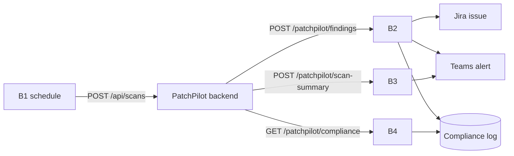

# Boomi team handoff

Share this file with the Boomi team. It is everything you need to build the PatchPilot integration in
Boomi with **Boomi Companion**. You own all Boomi work; the dev team never edits your processes.
The only coupling between our teams is HTTP: the endpoints, JSON shapes and auth below.
Source of truth: `docs/API_CONTRACTS.md` Part B and the JSON files in `contracts/boomi/`.
If you think a contract needs to change, tell the Lead (Roop) **before** building it.

## 1. What PatchPilot is (30 seconds)
PatchPilot scans a client's code for vulnerable libraries, uses AI to find the few that our code actually
calls, fixes them automatically and opens a GitHub pull request. **Boomi is the integration backbone:**
it starts the daily scans (B1) and turns every finding into a Jira ticket, a Teams alert and a compliance
log row (B2), posts a daily summary (B3), and serves the audit trail (B4).



## 2. Build order and timeline
| Order | ID | Process | Direction | Must work by | Why this order |
|---|---|---|---|---|---|
| 1 | **B0** | Setup: runtime, listener, auth, connections | — | 10:00 | Everything else needs it |
| 2 | **B2** | Finding notification → Jira + Teams + log | PatchPilot → Boomi | 11:15 | The main demo moment |
| 3 | **B1** | Daily scan trigger | Boomi → PatchPilot | 11:40 | Shows "fully automated, every day" |
| 4 | **B3** | Scan summary → Teams card | PatchPilot → Boomi | 11:50 | Nice-to-have |
| 5 | **B4** | Compliance report from the log | PatchPilot → Boomi | 11:50 | Nice-to-have (Compliance page) |

If time is short, finish B0 → B2 → B1. Until your endpoints are live the dev team runs with
`BOOMI_MODE=mock`, so nobody waits on anybody.

**Tonight (no process building, only accounts):** get Boomi access, a Jira project, a Teams channel
with a webhook, and a place for the compliance log (section 4). Check with the organisers whether
building processes before 9:20 is allowed; assume it is not.

## 3. B0 — Setup
1. **Runtime with a public URL.** Use a Boomi **Atom Cloud** (or a cloud-hosted Atom) so PatchPilot
   on Render/Railway can reach your listeners over HTTPS. A local Atom on a laptop is not reachable from outside.
2. **Shared Web Server:** REST listener enabled, authentication **Basic**. Create one user for PatchPilot
   in Shared Web Server → User Management. Its user name + token become our `BOOMI_USER` / `BOOMI_TOKEN`.
3. **Base URL:** something like `https://<cloud-host>/ws/rest`. Our client calls
   `${BOOMI_BASE_URL}/patchpilot/findings`, `.../patchpilot/scan-summary`, `.../patchpilot/compliance`.
   If Boomi forces different paths, tell us the exact paths; we can set them per endpoint
   (`BOOMI_B2_PATH`, `BOOMI_B3_PATH`, `BOOMI_B4_PATH`).
4. **Connections** (keep secrets inside Boomi):
   | Connection | Type | Settings |
   |---|---|---|
   | Jira | Jira connector, or HTTP Client | Jira Cloud site URL, user email + Jira API token (id.atlassian.com → Security → API tokens) |
   | Teams | HTTP Client | Teams webhook URL (section 6) |
   | Compliance log | Database / SharePoint / Google Sheets connector | Whatever you can read **and** write quickly (B4 reads it) |
   | PatchPilot | HTTP Client | `BACKEND_URL`, header `X-API-Key` (we send it privately) |
5. Deploy each process to the environment attached to the runtime, then test with the curl calls in section 9.

## 4. Compliance log — one row per finding
| Column | Type | From |
|---|---|---|
| compliance_log_id | string, you generate (e.g. `log_55`) | B2 |
| client_name, repo_url, cve_id, package, priority | string | B2 request |
| detected_at | ISO-8601 UTC | B2 request |
| fixed_at | ISO-8601 UTC, = processing time when `fix_status` = `fixed`, else empty | B2 |
| jira_key, pr_url | string | Jira response / B2 request |
| status | `fixed` / `needs_human` / `open` | B2 `fix_status` (`not_attempted` → `open`) |

`time_to_fix_minutes` for B4 = `fixed_at − detected_at` in whole minutes (empty if not fixed).
Options: a small cloud database (Postgres/MySQL), a SharePoint list, or a Google/Excel sheet — pick the one
your Boomi account already has a connector for.

## 5. B2 — Finding notification (the main one)
`POST ${BOOMI_BASE_URL}/patchpilot/findings` · Basic auth · `Content-Type: application/json` · reply within 15 s.
PatchPilot sends one call per reachable finding (usually 1–3 per scan). We retry once on 5xx.

**Request** (`contracts/boomi/B2_finding_request.json`):
```json
{
  "event": "finding.fixed",
  "scan_id": "scn_01",
  "finding_id": "fnd_07",
  "client_name": "Acme Retail",
  "repo_url": "https://github.com/<org>/demo-target",
  "cve_id": "CVE-2020-14343",
  "package": "pyyaml",
  "installed_version": "5.3.1",
  "fixed_version": "5.4.1",
  "cvss": 9.8,
  "priority": "P1",
  "score": 10.0,
  "reachability": "reachable",
  "confidence": 0.93,
  "summary": "Arbitrary code execution via full_load / FullLoader",
  "ai_explanation": "User-supplied YAML from POST /import reaches yaml.load without SafeLoader.",
  "evidence": [ { "file": "app/routes.py", "line": 42, "in_route": true } ],
  "fix_status": "fixed",
  "tests_passed": true,
  "pr_url": "https://github.com/<org>/demo-target/pull/3",
  "owner_email": "owner@easystepin.com",
  "detected_at": "2026-10-28T05:10:05Z"
}
```
Field notes: `event` finding.fixed / finding.needs_human / finding.open · `priority` P1–P4 ·
`reachability` reachable / unsure · `fix_status` fixed / needs_human / not_attempted ·
`pr_url` empty unless `fix_status` = `fixed` · `owner_email` may be empty · `evidence` has 1+ items.
Several findings in the same package share one `pr_url` (one PR per package) — still create one Jira issue per finding.

**Process steps**
1. Listener receives JSON → validate required fields (`cve_id`, `package`, `priority`, `client_name`). Missing → 400.
2. Decision on `priority`: P1/P2 = urgent branch (Jira Highest/High, Teams card marked urgent); P3/P4 = normal.
3. Create Jira issue (mapping below) → keep `key` and build `jira_url` = `<site>/browse/<key>`.
4. Post Teams message (section 6) with links to `pr_url` and `jira_url`.
5. Insert compliance log row (section 4).
6. Return the response.

**Jira mapping**
| Jira field | Value |
|---|---|
| Project | your project key (e.g. `SEC`) |
| Issue type | Bug (or Task) |
| Summary | `[{priority}] {cve_id} in {package} — {client_name}` |
| Priority | P1→Highest, P2→High, P3→Medium, P4→Low |
| Description | summary, ai_explanation, evidence `file:line` (+ "in web route" if `in_route`), `installed_version → fixed_version`, fix_status, tests_passed, pr_url |
| Labels | `patchpilot`, `security`, client name slug (e.g. `acme-retail`) |

Tip: Jira Cloud REST **v3** needs the description in Atlassian Document Format. If you use the HTTP Client,
call `/rest/api/2/issue`, which accepts a plain-text description.

**Response 200** (`contracts/boomi/B2_finding_response.json`):
```json
{ "ok": true, "jira_key": "SEC-101", "jira_url": "https://<site>.atlassian.net/browse/SEC-101",
  "teams_sent": true, "compliance_log_id": "log_55", "processed_at": "2026-10-28T05:11:40Z" }
```
If Teams fails but Jira worked, still return 200 with `"teams_sent": false`.
If Jira fails: 502 with `{ "ok": false, "error": "jira_create_failed", "message": "..." }`.

## 6. Teams message (B2 and B3)
Microsoft is retiring the old Office 365 "Incoming Webhook" connector. If you cannot create one, use the
Teams **Workflows** app → template "Post to a channel when a webhook request is received"; it gives a URL
that accepts an Adaptive Card wrapped like this:
```json
{ "type": "message",
  "attachments": [ { "contentType": "application/vnd.microsoft.card.adaptive",
                     "content": { "type": "AdaptiveCard", "version": "1.4", "body": [ ... ], "actions": [ ... ] } } ] }
```
**B2 card:** title `{priority} vulnerability fixed automatically` (or `{priority} vulnerability needs review`
when `fix_status` = `needs_human`) · facts: client, repo, CVE, package `installed → fixed`, why it is reachable
(`ai_explanation`), evidence `file:line` · buttons: "Open pull request" (`pr_url`), "Open Jira" (`jira_url`).

**B3 card:** title `PatchPilot daily scan — {client_name}` · facts: total alerts, real risks (reachable),
P1, P2, fixed, PRs opened · button: "Open dashboard" (`dashboard_url`).

## 7. B1 — Daily scan trigger (Boomi → PatchPilot)
- Trigger: process schedule daily 09:00, plus manual "Execute" during the demo.
- Client list: static JSON in a Message shape or a Cross Reference Table. For the demo, one entry:
  ```json
  [ { "client_name": "Acme Retail", "repo_url": "<DEMO_REPO_URL, we send it>", "branch": "main", "auto_fix": true,
    "owner_email": "<repo owner email>" } ]
  ```
- For each entry: `POST ${BACKEND_URL}/api/scans`, header `X-API-Key: <PATCHPILOT_API_KEY>`,
  `Content-Type: application/json`, body = the entry.
- Expected: `202 { "scan_id": "scn_01", "status": "queued" }` → log the scan_id (process log is enough).
- Until we share `BACKEND_URL` (~11:40), point the HTTP Client at a request-catcher such as webhook.site
  to check the body and headers, then swap the URL.

## 8. B3 and B4
**B3 — Scan summary** · `POST ${BOOMI_BASE_URL}/patchpilot/scan-summary` · one call at the end of each scan.
Request (`contracts/boomi/B3_scan_summary_request.json`):
```json
{ "event": "scan.completed", "scan_id": "scn_01", "client_name": "Acme Retail",
  "repo_url": "https://github.com/<org>/demo-target", "finished_at": "2026-10-28T05:11:42Z",
  "stats": { "total_alerts": 12, "reachable": 2, "unsure": 1, "not_reachable": 9, "p1": 1, "p2": 1, "fixed": 2, "prs_opened": 2 },
  "dashboard_url": "https://patchpilot.vercel.app/scans/scn_01" }
```
Steps: map stats → B3 Teams card → respond `200 { "ok": true, "teams_sent": true }`.

**B4 — Compliance report** · `GET ${BOOMI_BASE_URL}/patchpilot/compliance?client_name=Acme%20Retail&from=2026-10-01`
Steps: read query parameters → query the compliance log for that client with `detected_at >= from` → respond:
```json
{ "client_name": "Acme Retail", "from": "2026-10-01",
  "items": [ { "compliance_log_id": "log_55", "cve_id": "CVE-2020-14343", "package": "pyyaml", "priority": "P1",
               "detected_at": "2026-10-28T05:10:05Z", "fixed_at": "2026-10-28T05:11:40Z", "time_to_fix_minutes": 2,
               "jira_key": "SEC-101", "pr_url": "https://github.com/<org>/demo-target/pull/3", "status": "fixed" } ] }
```
No rows → `200` with `"items": []`. If a GET listener with query parameters is a problem in your setup,
tell the Lead by 10:30 so we agree on an alternative before anyone builds it.

## 9. Test calls
Run from the `patchpilot` repo root (Git Bash). Values come from section 10.
```bash
# B2
curl -u "$BOOMI_USER:$BOOMI_TOKEN" -H "Content-Type: application/json" \
  -d @contracts/boomi/B2_finding_request.json "$BOOMI_BASE_URL/patchpilot/findings"
# B3
curl -u "$BOOMI_USER:$BOOMI_TOKEN" -H "Content-Type: application/json" \
  -d @contracts/boomi/B3_scan_summary_request.json "$BOOMI_BASE_URL/patchpilot/scan-summary"
# B4
curl -u "$BOOMI_USER:$BOOMI_TOKEN" "$BOOMI_BASE_URL/patchpilot/compliance?client_name=Acme%20Retail&from=2026-10-01"
# B1 target (after T16): what Boomi sends to us
curl -H "X-API-Key: $PATCHPILOT_API_KEY" -H "Content-Type: application/json" \
  -d @contracts/api/scan_create_request.json "$BACKEND_URL/api/scans"
```
After T10 the dev team can also run `python -m app.services.boomi_client ping` to send the sample B2 call.

## 10. Exchange sheet
| You give us | When | How |
|---|---|---|
| `BOOMI_BASE_URL` and the exact paths for B2/B3/B4 | 10:30 | team chat |
| `BOOMI_USER` | 10:30 | team chat |
| `BOOMI_TOKEN` | 10:30 | **private message to the Lead only** — never in git or a shared channel |
| Jira site URL + project key, Teams channel name | 10:30 | team chat |
| "B2 passes the curl test" | 11:15 | team chat + screenshot of the Jira issue and Teams card |
| "B1 points at BACKEND_URL" | 11:40 | team chat |

| We give you | When |
|---|---|
| `DEMO_REPO_URL` and the B1 client list | tonight |
| `BACKEND_URL`, `FRONTEND_URL` | ~11:40 (after deploy) |
| `PATCHPILOT_API_KEY` | ~11:40, private message |

## 11. GitHub — how your work lands in our repo
Boomi processes live in the Boomi platform, not in git, so there is no code to merge. To keep the repo
the single place judges and teammates look:
1. The Lead adds each Boomi team member as a collaborator on `BommepalliRoop/patchpilot`.
2. Work on a branch `boomi-<id>` (e.g. `boomi-b2`) and add files only under `boomi/`:
   - `boomi/B2/README.md` — what the process does, shapes used, connections (no secrets)
   - `boomi/B2/screenshot.png` — the process canvas
   - `boomi/B2/sample-response.json` — a real response from your test call
   - component/process export (XML) if your account allows exporting it
   - `boomi/postman_collection.json` (optional)
3. Open a pull request to `main`; the Lead merges. Never commit tokens, passwords or webhook URLs.

## 12. Boomi Companion prompts
Paste these into Boomi Companion and adjust names. Paste the JSON files from `contracts/boomi/` where marked.

**B0**
"Set up a Web Services Server REST listener with Basic authentication on my Atom Cloud. Create connections for:
Jira Cloud (site URL, email, API token), an HTTP Client for a Microsoft Teams Workflows webhook, an HTTP Client
for an external REST API that needs an X-API-Key header, and a [database / SharePoint list / Google Sheet] for a
compliance log with columns: [paste section 4 table]."

**B2**
"Create a process with a Web Services Server listener for POST /patchpilot/findings that accepts this JSON
[paste B2_finding_request.json]. Validate cve_id, package, priority and client_name; return 400 if missing.
Add a Decision on priority: P1 or P2 go to an urgent branch. Create a Jira issue using this mapping
[paste Jira mapping table]. Post an Adaptive Card to the Teams webhook with the CVE, package, explanation and
links to pr_url and the new Jira issue. Insert a row into the compliance log. Return this JSON
[paste B2_finding_response.json]. If Teams fails, still return 200 with teams_sent false. If Jira fails,
return 502 with {ok:false, error:'jira_create_failed', message}."

**B1**
"Create a scheduled process (daily 09:00) that reads this client list [paste JSON from section 7] and for each
entry sends POST {BACKEND_URL}/api/scans with header X-API-Key and the entry as the JSON body. Log the scan_id
from the 202 response."

**B3**
"Create a process with a Web Services Server listener for POST /patchpilot/scan-summary that accepts this JSON
[paste B3_scan_summary_request.json], posts an Adaptive Card summary to the Teams webhook with the stats and a
link to dashboard_url, and returns {ok:true, teams_sent:true}."

**B4**
"Create a process with a Web Services Server listener for GET /patchpilot/compliance with query parameters
client_name and from. Query the compliance log for that client where detected_at >= from, compute
time_to_fix_minutes, and return this JSON [paste B4_compliance_response.json]. Return items: [] when nothing matches."
