# Diagrams (HLD + LLD)

Mermaid diagrams; GitHub renders them inline. Text source of truth stays in `docs/ARCHITECTURE.md`
and `docs/API_CONTRACTS.md` — if a diagram disagrees with those, the docs win.

Contents
1. HLD — system context
2. HLD — pipeline and gating
3. HLD — deployment
4. LLD — scan sequence (end to end)
5. LLD — backend modules
6. LLD — reachability algorithm
7. LLD — fix engine state machine
8. LLD — data model (ER)
9. LLD — status enums
10. LLD — frontend routes and data flow
11. Delivery — task dependency graph

---

## 1. HLD — system context
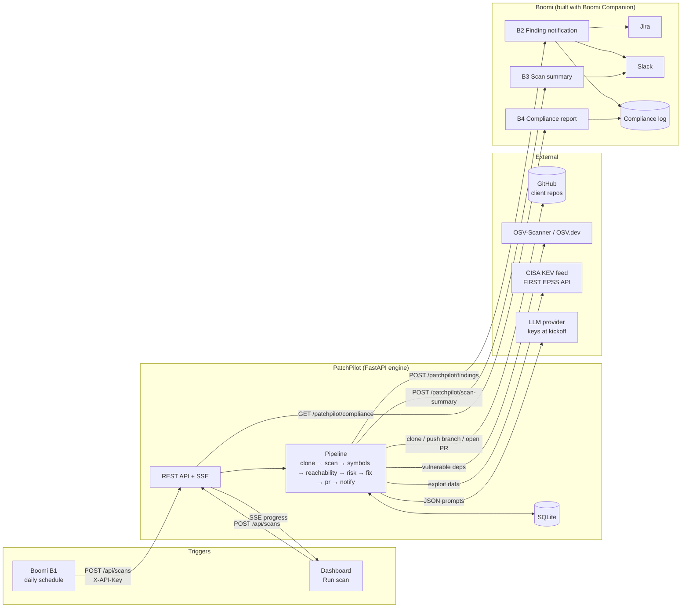

## 2. HLD — pipeline and gating
Only `reachable` findings, and `unsure` with confidence ≥ 0.5, go on to fix / PR / notify automatically.
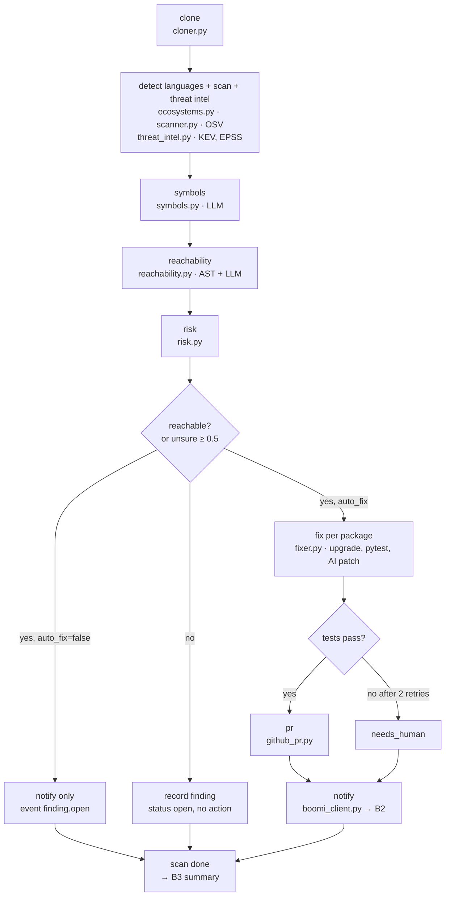

## 3. HLD — deployment
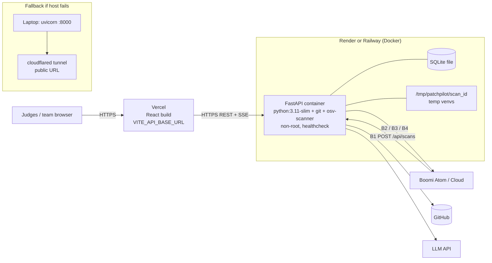

## 4. LLD — scan sequence (end to end)
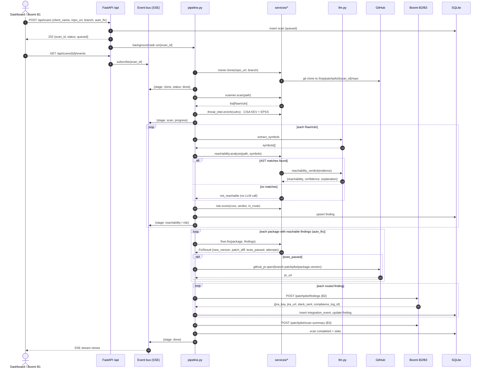

## 5. LLD — backend modules
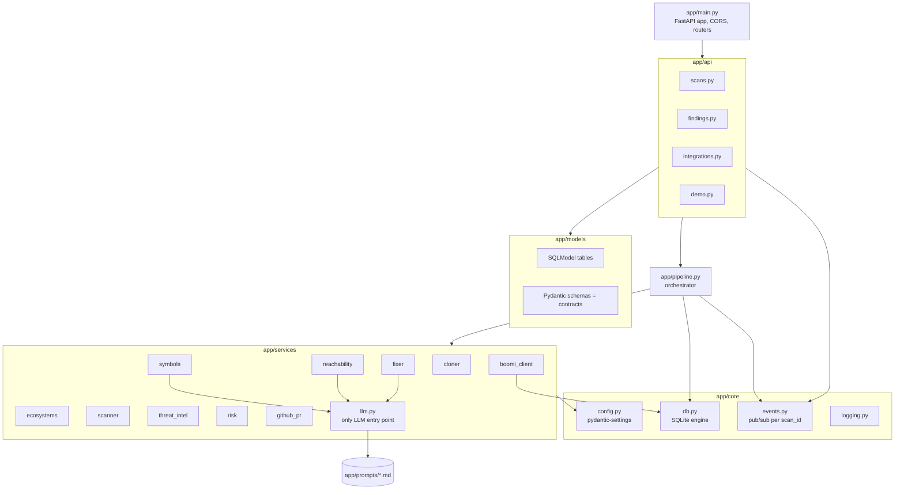

## 6. LLD — reachability algorithm
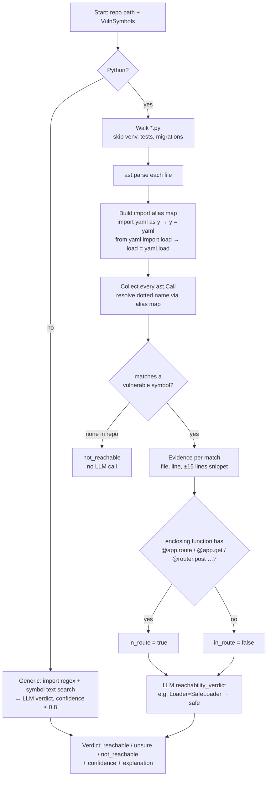

Risk: `score = min(10, cvss × reach_w × exposure_w × threat_w)`; reach_w 1.0 / 0.6 / 0.3; exposure_w 1.5 if any `in_route`;
threat_w 1.3 if in CISA KEV, 1.1 if EPSS percentile ≥ 0.9.
Priority ≥9 P1, ≥7 P2, ≥4 P3, else P4.

## 7. LLD — fix engine state machine
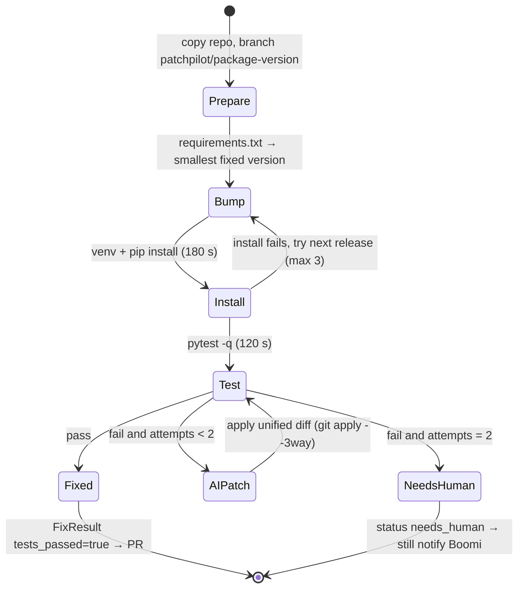

## 8. LLD — data model (ER)
```mermaid
erDiagram
    SCANS ||--o{ FINDINGS : has
    SCANS ||--o{ FIXES : has
    FIXES ||--o{ FINDINGS : "fixes (one per package)"
    FINDINGS ||--o{ INTEGRATION_EVENTS : logs

    SCANS {
        string id PK
        string client_name
        string repo_url
        string branch
        bool auto_fix
        string owner_email
        string status
        string current_stage
        datetime started_at
        datetime finished_at
        int total_alerts
        int reachable_count
        int p1_count
    }
    FINDINGS {
        string id PK
        string scan_id FK
        string fix_id FK
        string cve_id
        json aliases_json
        string package
        string installed_version
        string fixed_version
        string summary
        float cvss
        bool kev
        date kev_date_added
        float epss
        float epss_percentile
        json vulnerable_symbols_json
        string reachability
        float confidence
        json evidence_json
        text ai_explanation
        float score
        string priority
        string status
        string jira_key
        string jira_url
        bool slack_sent
        string compliance_log_id
        json timeline_json
    }
    FIXES {
        string id PK
        string scan_id FK
        string package
        string new_version
        text patch_diff
        bool tests_passed
        int attempts
        string pr_url
        string status
    }
    INTEGRATION_EVENTS {
        int id PK
        string finding_id FK "nullable for B3/B4"
        string process "B1-B4"
        string direction
        string endpoint
        json request_json
        json response_json
        int status_code
        bool ok
        string summary
        datetime created_at
    }
```

## 9. LLD — status enums
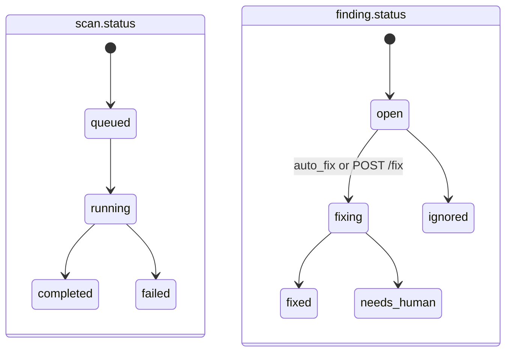

## 10. LLD — frontend routes and data flow
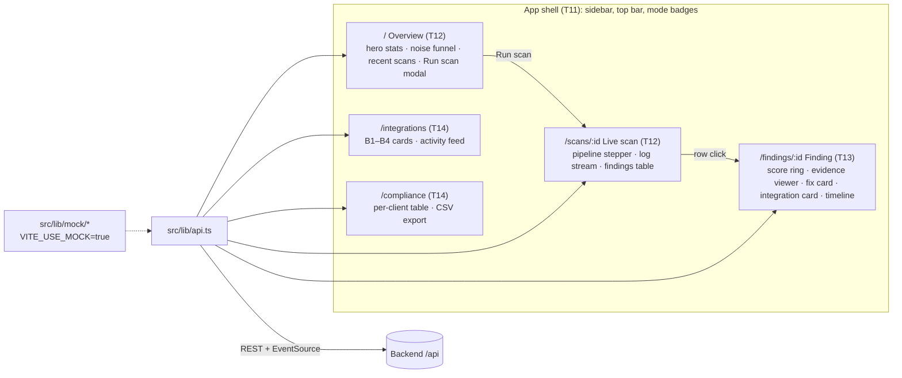

## 11. Delivery — task dependency graph
Model / effort per task is in brackets. Queue after each task: `tasks/BOARD.md` → "Task queue".
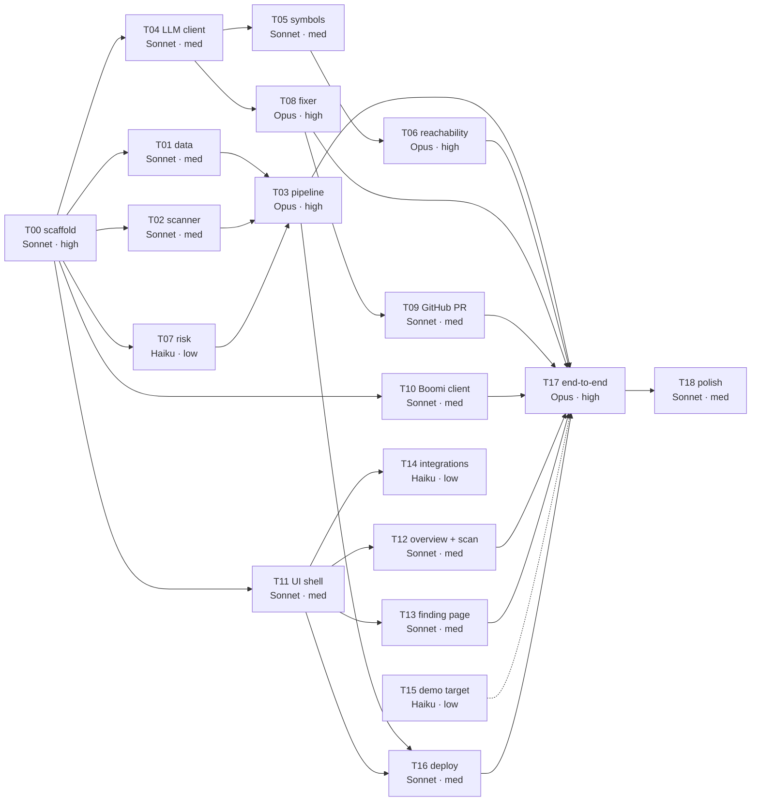
